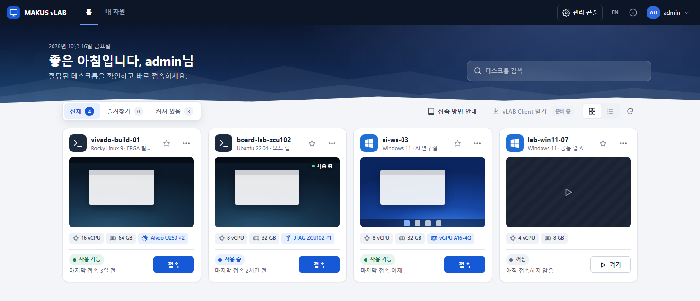
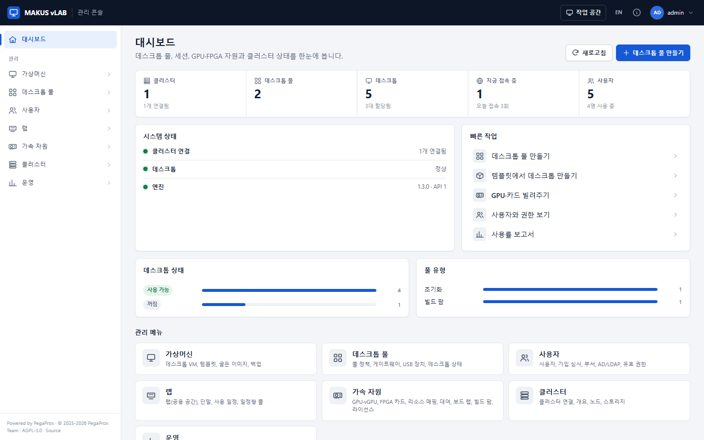
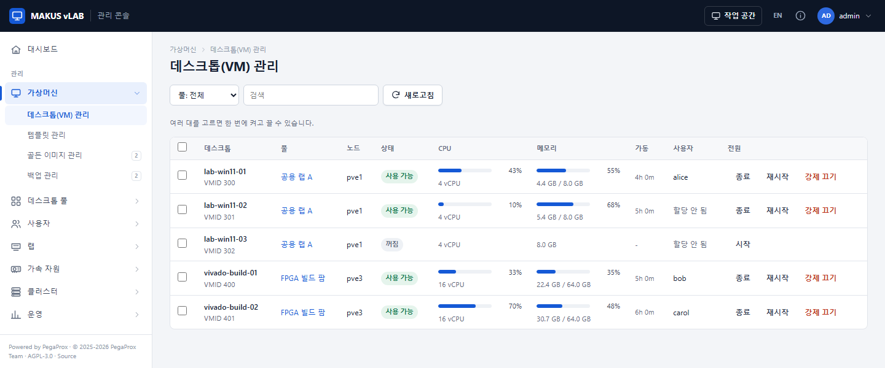
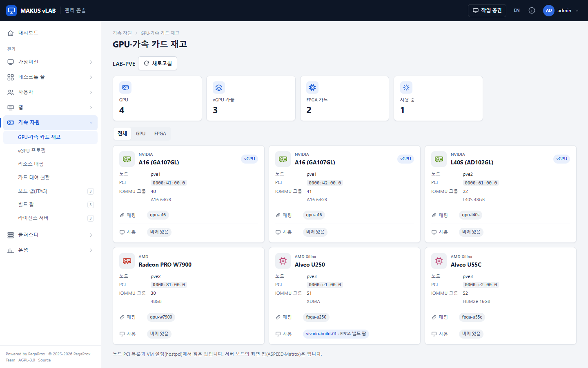
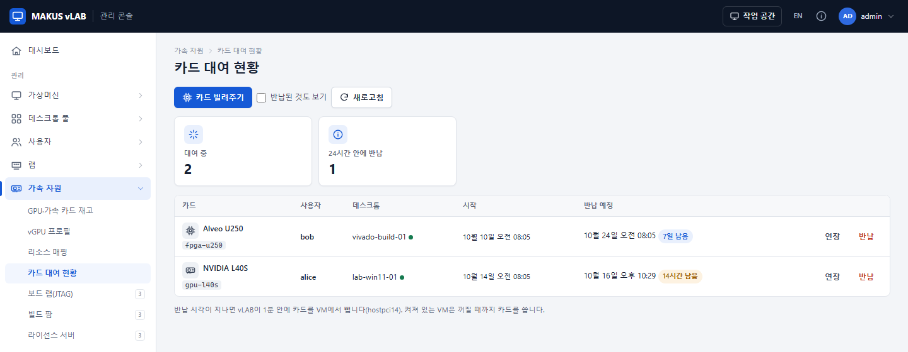
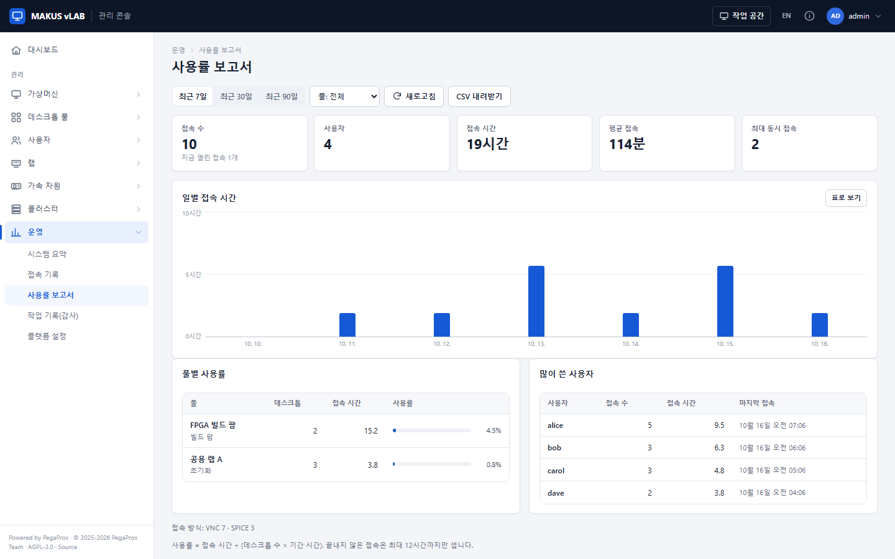
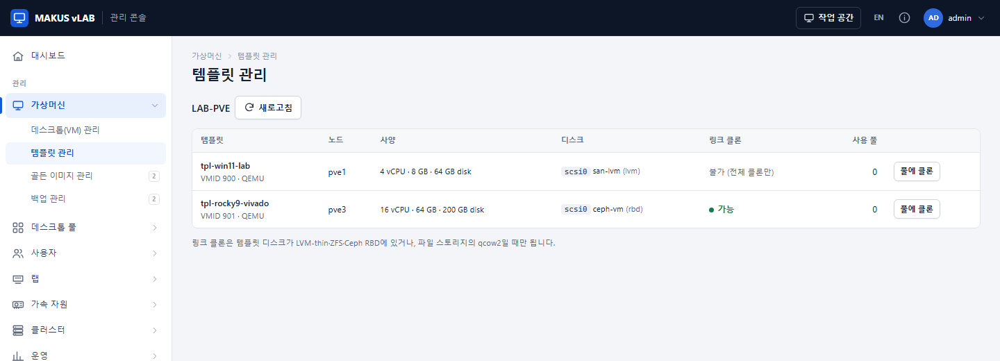
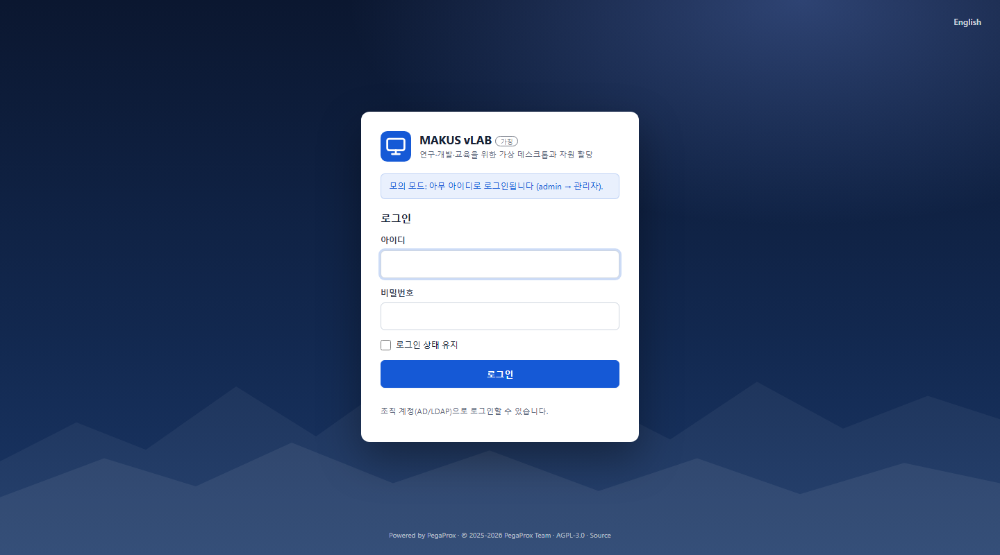

<p align="center">
  
</p>

<h1 align="center">MAKUS vLAB 콘솔</h1>

<p align="center">
  연구소·기업·교육 기관의 LAB과 FPGA 개발 조직을 위한 가상 데스크톱(VDI) — <b>사용자 작업 공간</b>과 <b>관리 콘솔</b>
</p>

<p align="center">
  <a href="https://github.com/dskim1979/makus-vlab">엔진(makus-vlab)</a> ·
  <a href="deploy/README.md">서버에 설치</a> ·
  <a href="NOTICE.md">고지</a>
</p>

---

## 화면

### 사용자 작업 공간 (`/`)
배정된 데스크톱을 한 화면에서 보고 바로 접속합니다. 즐겨찾기, 켜져 있는 것만 보기, 검색, 브라우저 접속(noVNC)과 SPICE 접속을 지원하고,
GPU·vGPU·FPGA 카드가 붙은 데스크톱은 카드에 표시됩니다.


### 관리 콘솔 (`/admin`)

| | |
|---|---|
| **대시보드** — 클러스터·풀·데스크톱·세션·사용자 숫자, 시스템 상태, 빠른 작업 | **데스크톱(VM) 관리** — 사용량, 전원(한 대씩·여러 대 한 번에) |
|  |  |
| **GPU·가속 카드 재고** — NVIDIA·AMD·Intel GPU, vGPU 가능 여부, FPGA 카드, 리소스 매핑, 사용 중인 VM | **카드 대여 현황** — GPU·FPGA 카드를 데스크톱에 기간을 정해 빌려주기, 연장·반납·자동 반납 |
|  |  |
| **사용률 보고서** — 7·30·90일, 일별 접속 시간, 풀별 사용률, 많이 쓴 사용자, CSV | **템플릿 관리** — 디스크·링크 클론 가능 여부·사용 풀, 여기서 풀에 클론 |
|  |  |

### 로그인


## 기능 한눈에

| 모듈 | 화면 |
|---|---|
| 가상머신 | 데스크톱(VM) 관리, 템플릿 관리 · *(예정)* 골든 이미지, 백업 |
| 데스크톱 풀 | 풀 관리(전용·초기화·공유·일정형·빌드 팜), 템플릿 일괄 복제, 할당, 초기화, 풀 GPU 정책, 데스크톱 상태 |
| 사용자 | 사용자 목록, 도메인(AD/LDAP) 설정·시험, 유효 권한 조회 |
| 랩 | *(예정)* 랩(공용 공간)·단말, 사용 일정(교육·교대 근무·예약), 일정형 풀 |
| 가속 자원 | GPU·가속 카드 재고, vGPU 프로필, 리소스 매핑, 카드 대여 현황 · *(예정)* 보드 랩(JTAG), 빌드 팜, 라이선스 서버 |
| 클러스터 | 개요, 노드, 스토리지, 클러스터 연결 |
| 운영 | 시스템 요약, 접속 기록, 사용률 보고서, 작업 기록(감사), 플랫폼 설정(로그인·비밀번호·감사 보관·폐쇄망·메일) |

화면은 한국어·영어, 밝은·어두운 모드를 지원합니다.

## 실행

```bash
npm install
npm run dev:mock   # 엔진 없이 화면만 (아무 아이디로 로그인, admin → 관리자)
npm run dev        # 엔진에 연결 (VLAB_ENGINE_URL, 기본 https://localhost:5000)
npm run build      # dist/ — nginx 가 정적 파일로 제공
```

`npm run dev:mock` 에서 주소에 `?as=admin` 을 붙이면 로그인 없이 바로 들어갑니다(시연·화면 캡처용, 모의 모드에서만).

`npm run dev` 는 `/api`·`/ws` 를 엔진으로 넘깁니다(vite.config.ts). 운영에서는 nginx 가 같은 역할을 합니다.
**프록시는 Host 헤더를 바꾸면 안 됩니다** — 엔진의 CSRF 검사가 `Origin` 과 `Host` 를 비교하므로 Vite 는 `changeOrigin: false`,
nginx 는 `proxy_set_header Host $http_host;` 로 둡니다.

## 서버에 설치

[deploy/README.md](deploy/README.md) — docker compose 로 콘솔(nginx, HTTPS)과 엔진(API 전용)을 한 서버에 설치합니다.

## 구조

| 경로 | 내용 |
|---|---|
| `src/brand.ts` | 제품명·회사·엔진 고지 정보 |
| `src/i18n/` | 한/영 문구 (키마다 `ko`·`en`) |
| `src/api/` | 엔진 API(`client.ts`, `admin.ts`), 모의 엔진(`mock.ts`, `mockAdmin.ts`), 타입 |
| `src/auth/` | 세션, 로그인(비밀번호 → 필요 시 TOTP, OIDC, LDAP 안내), 첫 설정 |
| `src/admin/` | 모듈·페이지 정의(`modules.ts`), 대시보드, 모듈 화면 |
| `src/portal/` | 작업 공간(데스크톱 타일·목록), 내 자원, 브라우저 콘솔 |
| `src/components/` | 상단 막대, 왼쪽 메뉴, 화면 틀, 고지, 대화 상자, 아이콘 |
| `deploy/` | Dockerfile·nginx·docker compose 설치 묶음 |

엔진과는 HTTP API 로만 통신합니다 — 인증은 엔진의 `/api/auth/*`, 그 밖은 vLAB API `/api/vlab/*` 만 씁니다.

## 고지·라이선스

- 모든 화면 하단·로그인·정보 창의 **"Powered by PegaProx"** 고지는 엔진의 AGPL-3.0 제7조(b) 저작자 표시라 지우거나 가리지 않습니다
  (`src/components/EngineNotice.tsx`, [NOTICE.md](NOTICE.md)).
- 이 콘솔의 라이선스는 (주)매커스시스템즈가 정합니다(`UNLICENSED`, 별도 허락 없이 사용·배포할 수 없음). 사용한 공개 라이브러리는 [NOTICE.md](NOTICE.md).
