# MOAVI Desk — FPGA · AI 연구실

GPU · vGPU · MIG · FPGA · 국산 NPU를 여러 사람이 나눠 쓰는 연구실 구성입니다. 기간 대여 · 예약 · GPU 작업 큐 · 웹 IDE · 빌드 팜 · 보드 LAB으로 자리에서 개발합니다.

| 사이트 프로필 | 켜지는 기능 | 관리 콘솔 |
|---|---|---|
| **연구소 · 기업 R&D** + FPGA 개발 + GPU · AI 연구 | 조직 · 권한, 외부 접속, 연구 데이터 + FPGA 개발 + GPU · AI 연구 | 메뉴 7개 · 화면 22개 |

**관리 콘솔 메뉴** (이 구성에서 보이는 것만)

- 가상머신 — 데스크톱(VM) · 이미지(환경 카탈로그 포함)
- 데스크톱 풀 — 풀 · 접속 설정
- 사용자 — 사용자 · 권한
- 가속 자원 — 카드 · 카드 대여(예약) · GPU 작업 · 보드 LAB · 빌드 팜(CI 연동 · 결과물 보관) · 라이선스 서버
- 연구 데이터
- 클러스터
- 운영

## 무엇이 좋아지나

| | |
|---|---|
| **카드 풀 공유** | 자리에 묶인 GPU · FPGA · NPU를 기간 대여 · 예약으로 여러 사람이 씁니다. 오래 쓰지 않으면 회수. |
| **GPU 작업 큐** | 할당량 · 월 GPU-시간 · 공정 분배로 학습 순서를 정하고 GPU-시간으로 비용을 나눕니다. |
| **맞춰진 환경** | 환경 카탈로그 · 웹 IDE(JupyterLab · VS Code)로 CUDA · 툴체인이 맞는 환경을 바로. |
| **FPGA 개발** | 보드 LAB(JTAG) · 빌드 팜 · CI 연동 · 결과물 보관 · 라이선스 사용 현황 감시. |
| **연구 데이터** | 데이터셋과 반출 승인, 대용량 분할 업로드. |

## 화면

아래 화면은 이 구성(사이트 프로필)으로 켰을 때 그대로입니다 — 꺼진 기능의 메뉴는 보이지 않습니다.

| | |
|---|---|
| **작업 공간 — GPU · FPGA 카드 표시** | **내 자원 — 빌린 카드 · 내 GPU · 작업 큐** |
| 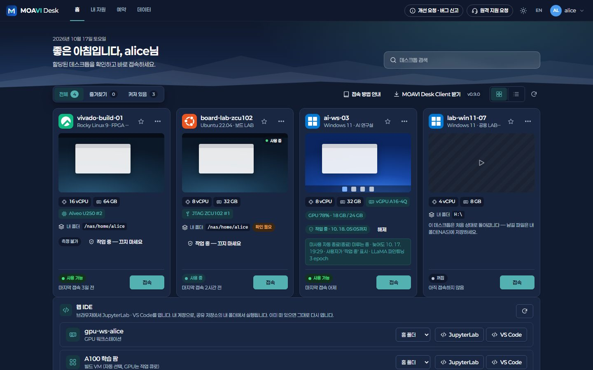 | 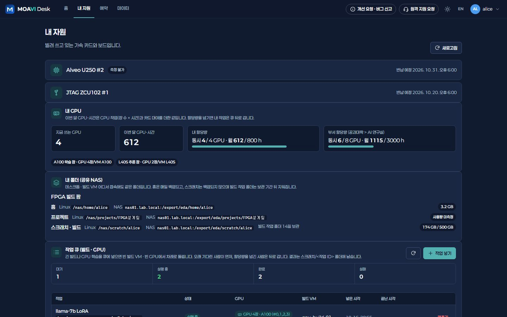 |
| **포털 예약 › 카드 · 보드** | **카드 — 재고 · vGPU · MIG** |
| 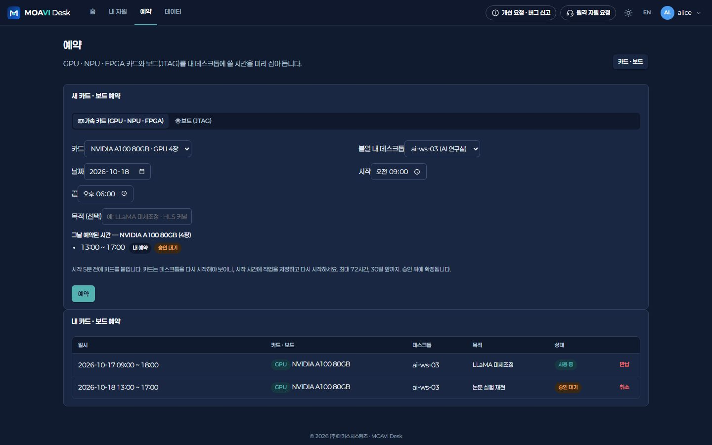 | 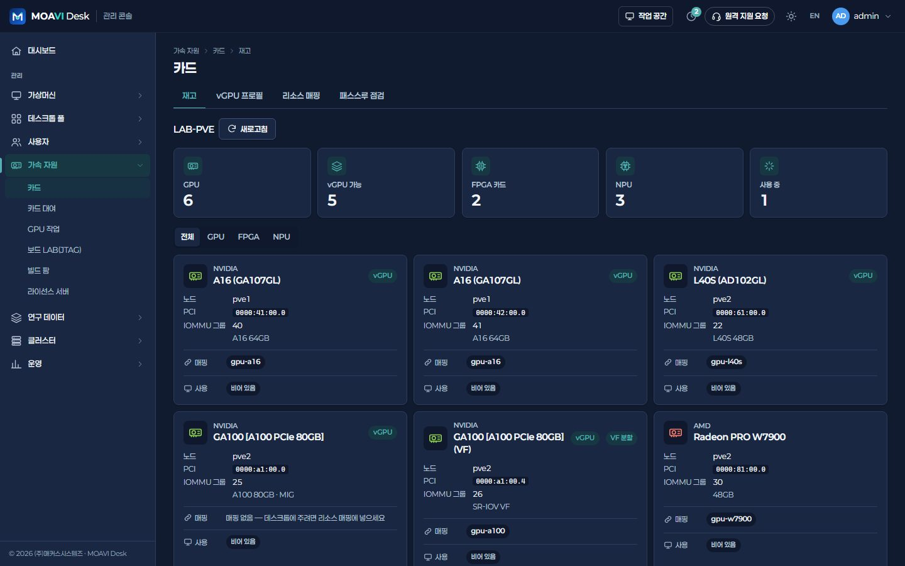 |
| **카드 대여 — 실사용률 · 회수** | **카드 대여 › 예약 — 승인** |
| 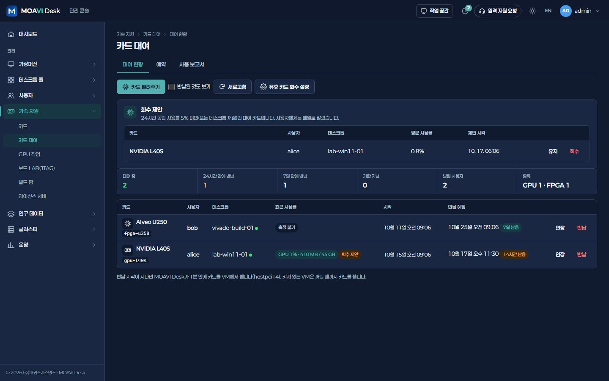 | 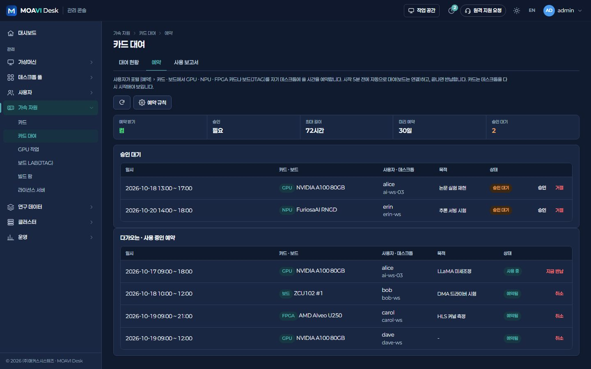 |
| **GPU 작업 큐** | **GPU 할당량** |
| 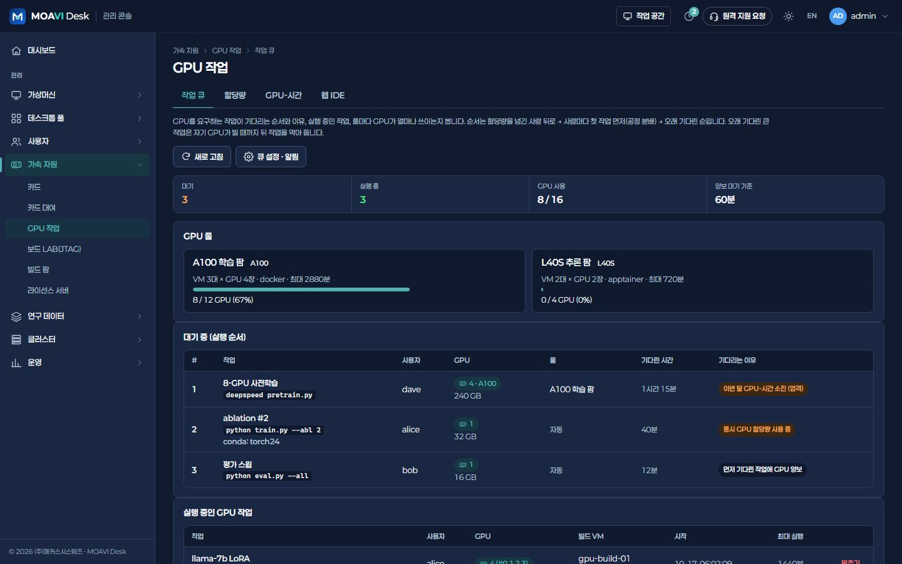 | 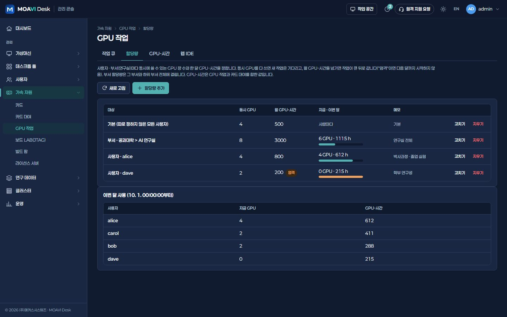 |
| **웹 IDE 세션** | **환경 카탈로그** |
| 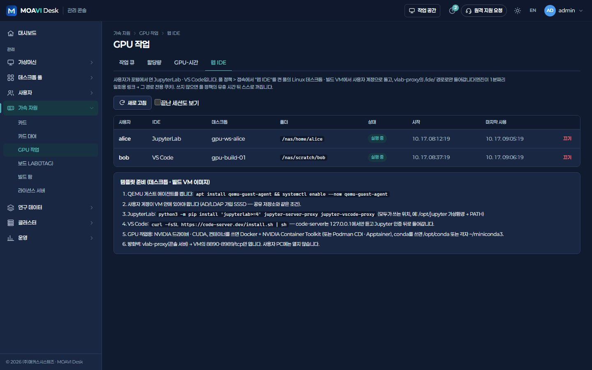 | 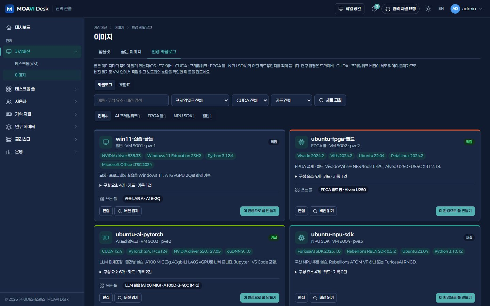 |
| **보드 LAB(JTAG)** | **빌드 팜 › 작업 큐** |
| 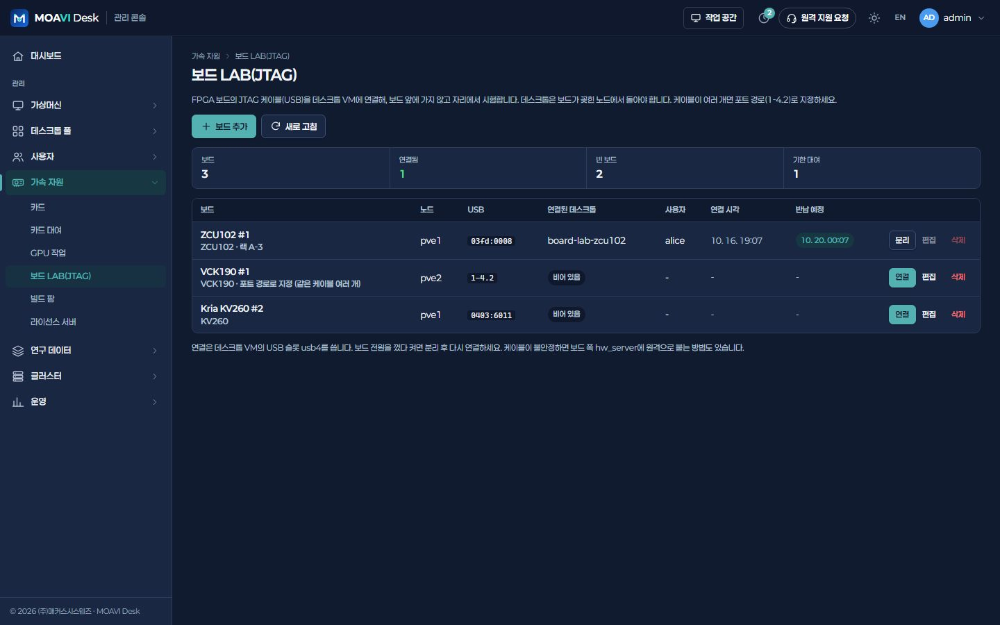 | 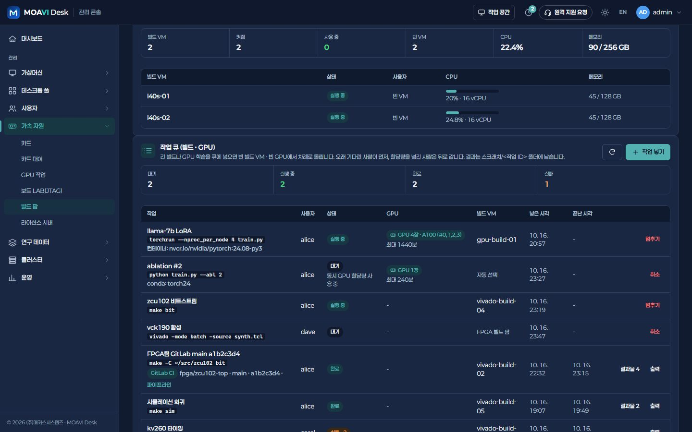 |
| **빌드 팜 › CI 연동** | **빌드 결과물** |
| 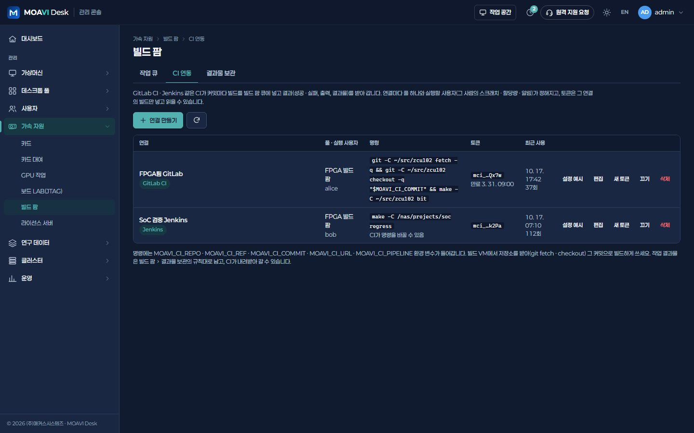 | 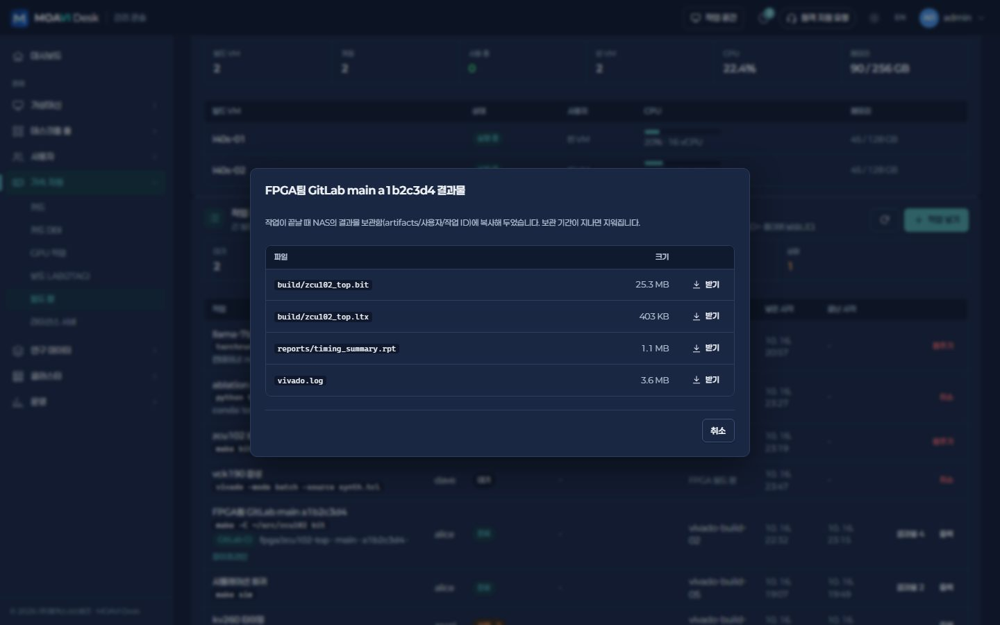 |
| **라이선스 서버 › 사용 현황** | |
| 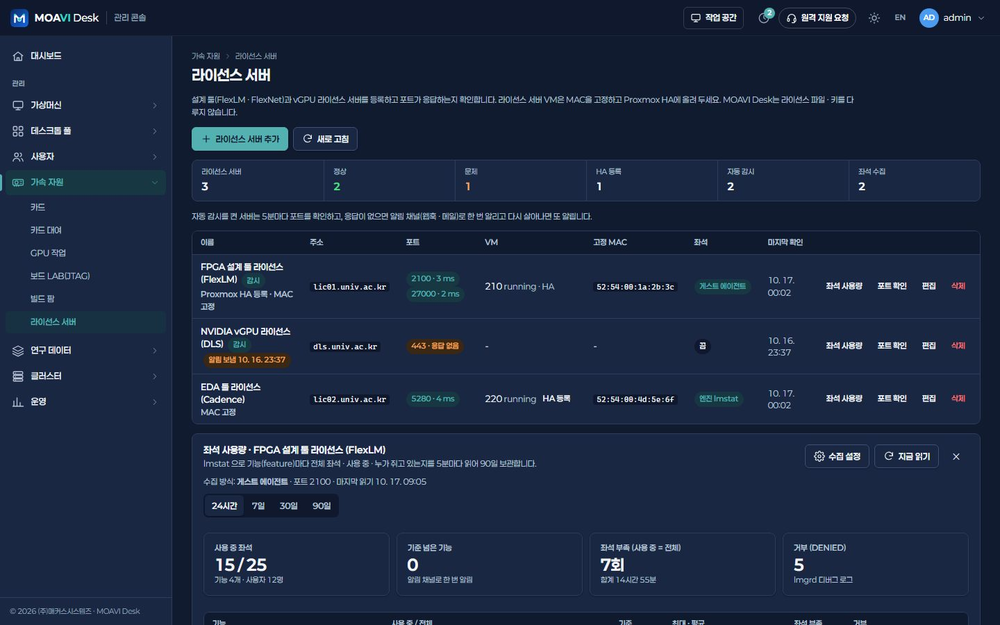 | |

## 구성 예시

예시입니다. 업무 프로그램 · 동시 접속 · 카드 모델에 맞춰 사양을 정합니다.

| 구분 | 구성 |
|---|---|
| GPU 노드 | 2노드 · 노드당 GPU 4장(A100 · L40S 등), vGPU · MIG |
| FPGA 노드 | 1노드 · Alveo 카드 4장 + JTAG 보드 6개 |
| 일반 노드 | 2노드 · 개발 데스크톱 30대 + 빌드 VM |
| 스토리지 | NAS(홈 · 스크래치 · 데이터셋 · artifacts) + Ceph |
| 라이선스 | FlexLM(Vivado · EDA) · NVIDIA vGPU 라이선스 서버 |

## 설치

1. [서버에 설치](../../deploy/README.md) — Linux 서버 한 대에 docker compose로 콘솔 · 엔진 · Guacamole을 올립니다.
2. 처음 관리자로 들어가면 **어떤 곳에서 쓰시나요?** 가 뜹니다 → **연구소 · 기업 R&D** + FPGA 개발 · GPU · AI 연구 를 고르고 **이대로 시작**.
   무인 설치라면 `.env`에 `VLAB_PROFILE=research`, `VLAB_FEATURES=fpga,gpuai`.
3. 클러스터 연결 → (필요하면) AD/LDAP → 템플릿 · 골든 이미지 → 풀 → 이용 권한 순서로 준비합니다.

나중에 다른 기능이 필요하면 **운영 > 플랫폼 설정 > 기능**에서 묶음을 켜고 끕니다. 꺼도 데이터는 지워지지 않습니다.

---

MOAVI Desk는 **100% 무료 오픈소스**입니다(콘솔 · 엔진 AGPL-3.0, 클라이언트 MIT). 유상은 (주)매커스시스템즈의 구축 대행뿐입니다.
다른 사이트 종류: [일반 업무 VDI](general.md) · [대학교 실습실](university.md) · [연구소 · 기업 R&D](research.md)
