# MOAVI Desk — 일반 업무 VDI

본사 · 지점 · 재택 근무자가 어디서나 같은 업무 데스크톱에 접속하는 사무실 VDI입니다. 데스크톱 100대 안팎을 꼭 필요한 메뉴만으로 운영합니다.

| 사이트 프로필 | 켜지는 기능 | 관리 콘솔 |
|---|---|---|
| **일반 업무 VDI** | 조직 · 권한, 외부 접속 | 메뉴 5개 · 화면 14개 |

**관리 콘솔 메뉴** (이 구성에서 보이는 것만)

- 가상머신 — 데스크톱(VM) · 이미지(템플릿 · 골든 이미지)
- 데스크톱 풀 — 풀 · 접속 설정(게이트웨이 · USB · 외부 데스크톱)
- 사용자 — 사용자(목록 · 일괄 등록) · 권한(역할)
- 클러스터 — 개요 · 노드 · 스토리지 · 클러스터 연결
- 운영 — 요약 · 기록 · 보고서 · 경보 · 백업 · 플랫폼 설정

## 무엇이 좋아지나

| | |
|---|---|
| **PC를 한 번에** | 골든 이미지 하나를 고치면 부서 데스크톱 전체가 새 버전으로 바뀝니다(사용자 · 권한 그대로). |
| **어디서나 같은 자리** | 재택 · 지점 · 출장지에서 브라우저나 Windows 클라이언트로, 밖에서는 RD 게이트웨이 · 브라우저 RDP로. |
| **AD 그대로** | 기관 계정으로 로그인하고 부서 · AD 그룹 단위로 데스크톱을 줍니다. |
| **자료는 서버에** | 사용자 PC에는 화면만. 바탕 화면 · 문서는 NAS 홈 드라이브로, C 드라이브는 숨기고, 클립보드 · USB · 내 PC 드라이브 · 프린터는 풀 정책으로. 접속 · 작업 기록이 남습니다. |
| **미리 대비** | 대시보드의 자원 제안과 증설 예측으로 언제 서버를 늘릴지 봅니다. |

## 화면

아래 화면은 이 구성(사이트 프로필)으로 켰을 때 그대로입니다 — 꺼진 기능의 메뉴는 보이지 않습니다.

| | |
|---|---|
| **작업 공간 — 내 데스크톱, 접속 방법** | **할당 가능한 데스크톱 · 외부 데스크톱(실제 PC)** |
| 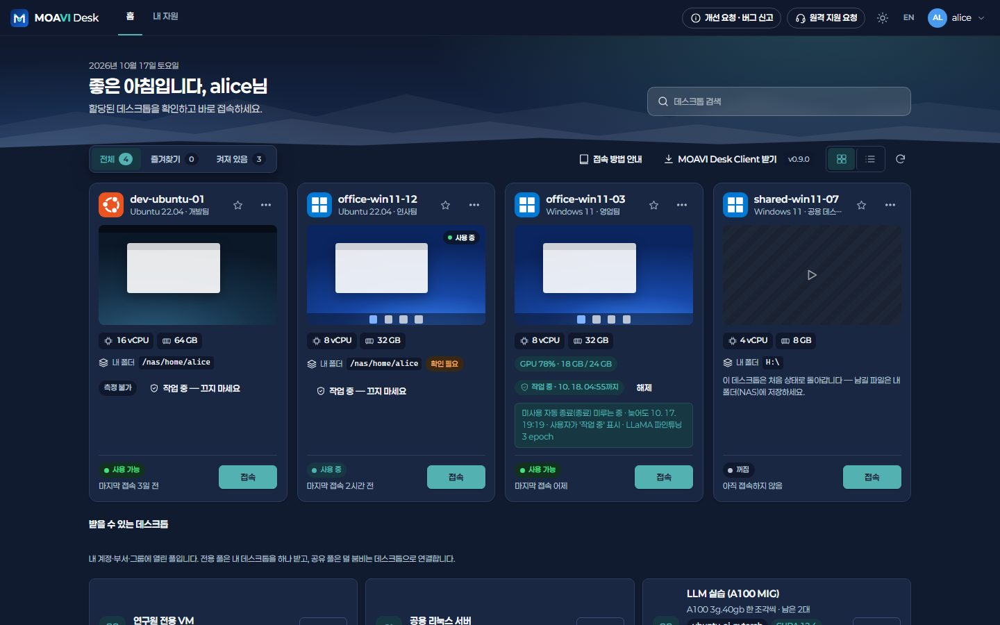 | 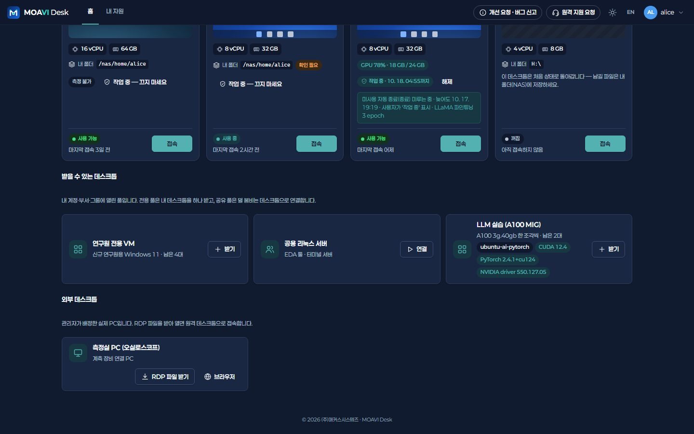 |
| **대시보드 — 상태 · 추이 · 자원 제안** | **증설 예측 — 기준에 닿는 날** |
| 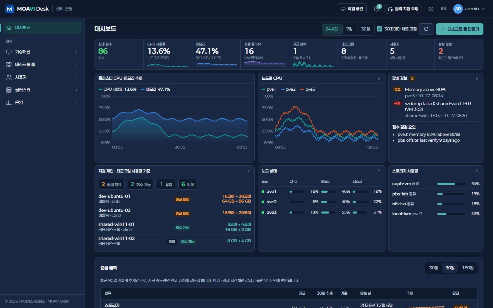 | 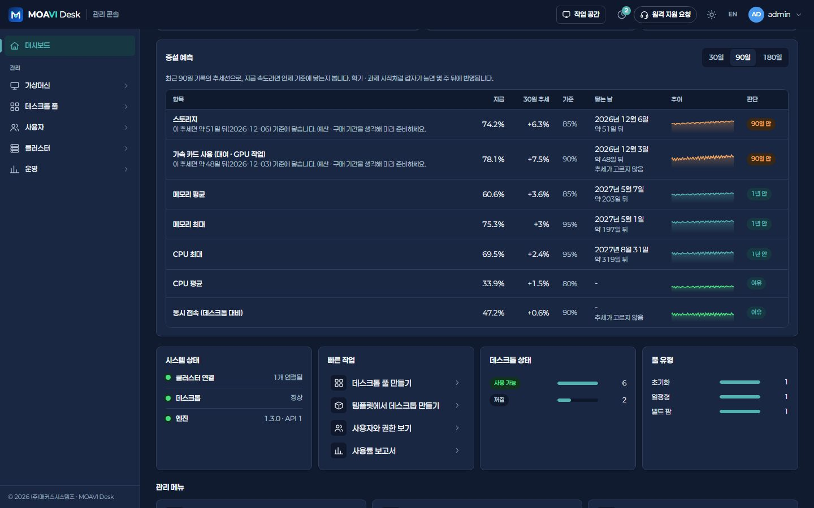 |
| **데스크톱(VM) 목록 — 사용량 · 전원** | **골든 이미지 — 버전 · 배포** |
| 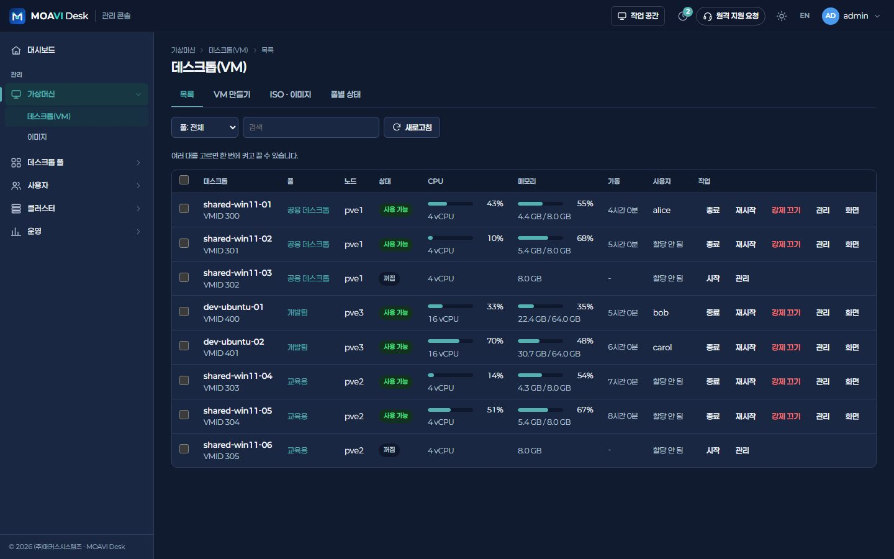 | 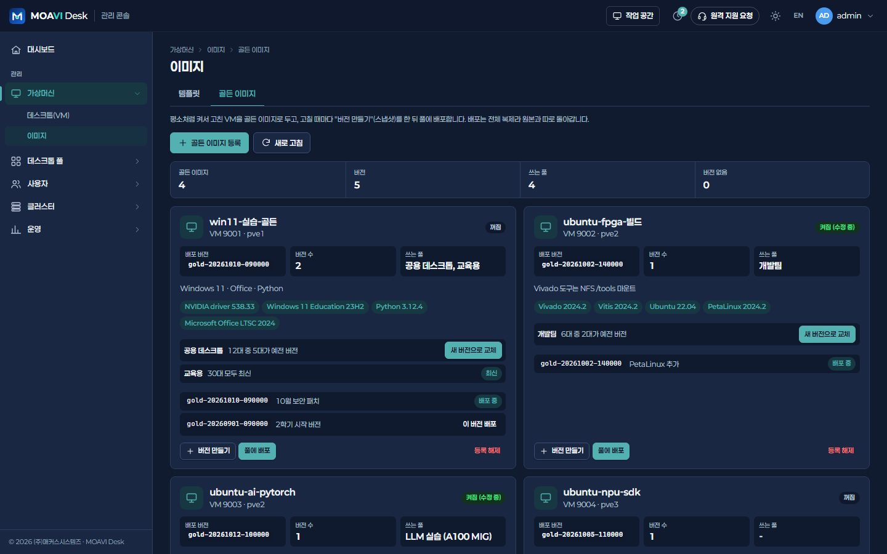 |
| **풀 이용 권한 — 사용자 · 부서 · AD 그룹** | **게이트웨이 — RD 게이트웨이 · Guacamole** |
| 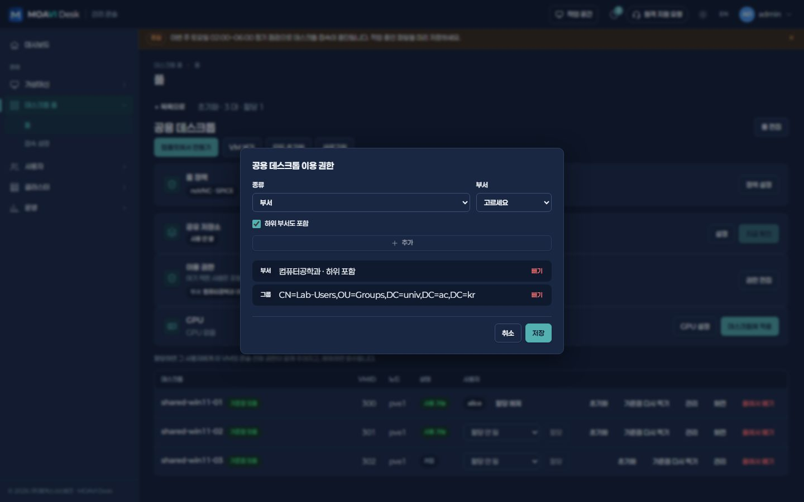 | 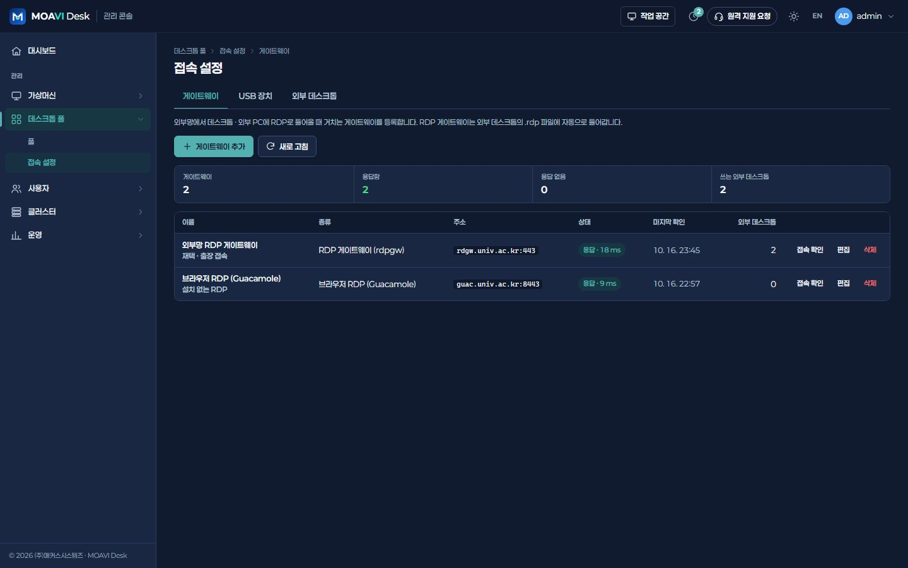 |
| **외부 데스크톱 — 가상화하지 않는 PC** | **사용자 — 만들기 · 초기화 · 만료** |
| 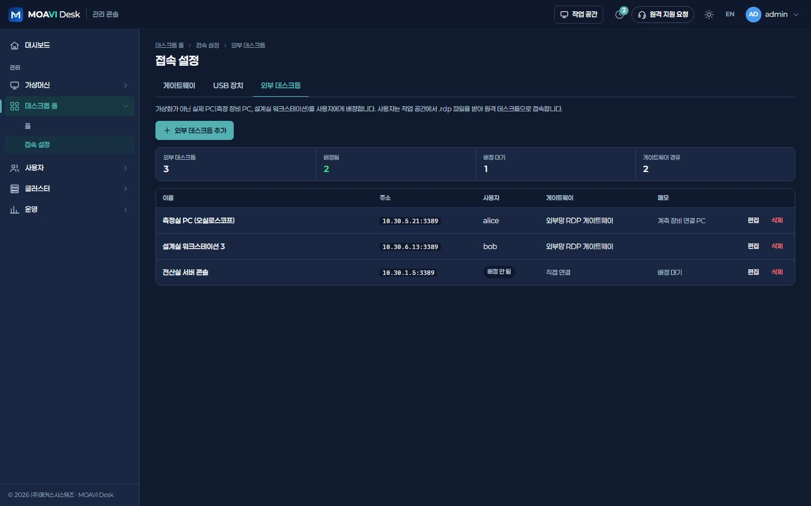 | 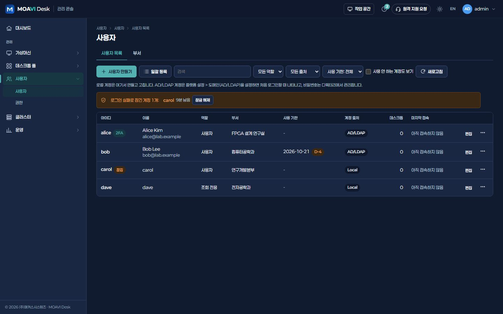 |
| **접속 기록 — 끊기** | **백업 (PBS)** |
| 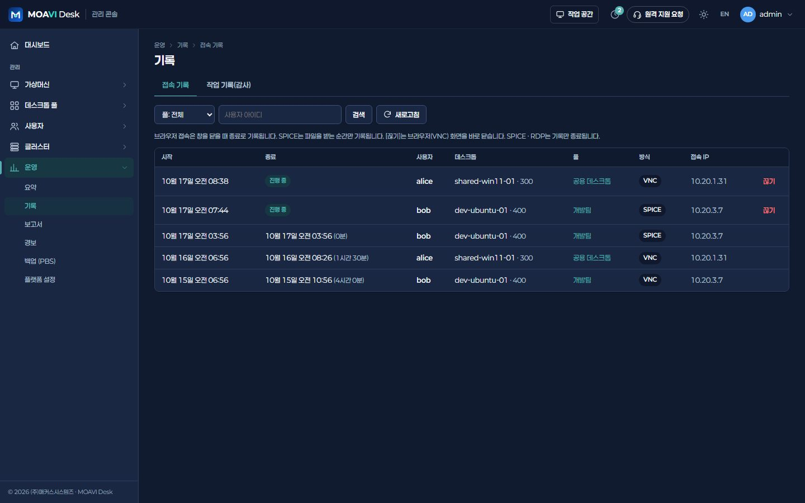 | 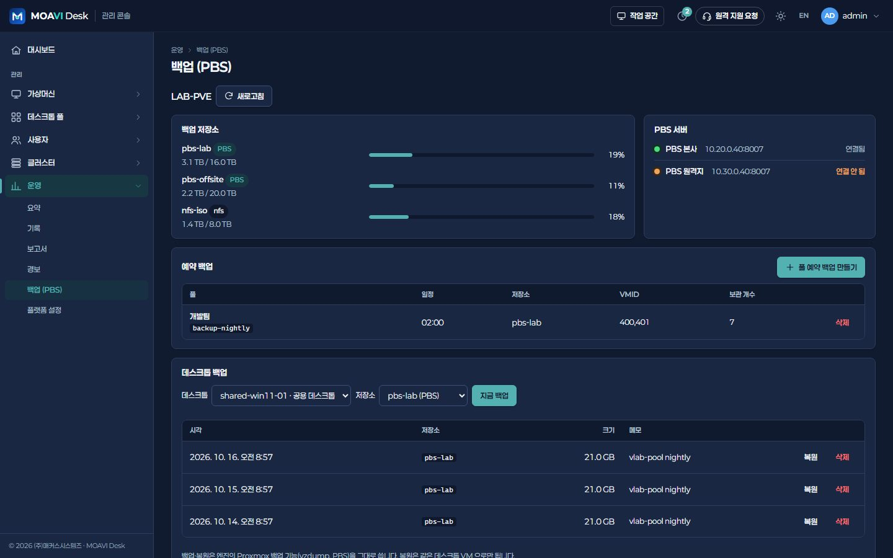 |
| **플랫폼 설정 › 기능 — 일반 업무 VDI** | |
| 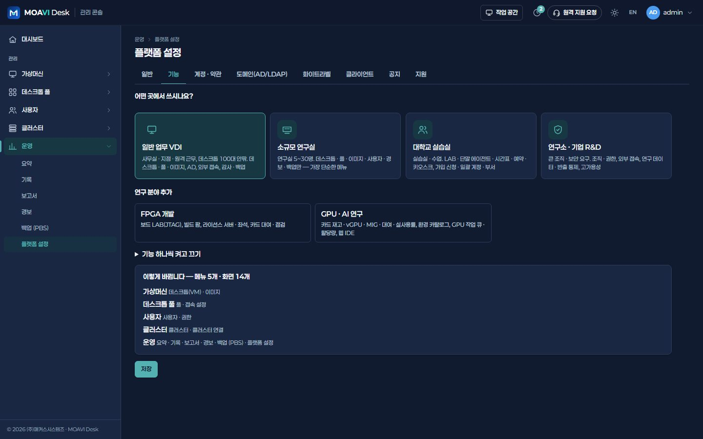 | |

## 구성 예시

예시입니다. 업무 프로그램 · 동시 접속 · 카드 모델에 맞춰 사양을 정합니다.

| 구분 | 구성 |
|---|---|
| 데스크톱 | Windows 11 · 4 vCPU · 8 GB · 80 GB, 100대 (동시 80명 안팎) |
| 서버 | 3노드 · 노드당 CPU 2소켓 32코어 · 메모리 512 GB |
| 스토리지 | Ceph NVMe 3노드 또는 공유 스토리지 · 링크 클론 |
| 네트워크 | 스토리지 · 서비스 25 GbE, 재택 · 지점은 게이트웨이(443) |
| 관리 · 백업 | MOAVI Desk 서버 1대 + PBS |

## 설치

1. [서버에 설치](../../deploy/README.md) — Linux 서버 한 대에 docker compose로 콘솔 · 엔진 · Guacamole을 올립니다.
2. 처음 관리자로 들어가면 **어떤 곳에서 쓰시나요?** 가 뜹니다 → **일반 업무 VDI** 를 고르고 **이대로 시작**.
   무인 설치라면 `.env`에 `VLAB_PROFILE=general`.
3. 클러스터 연결 → (필요하면) AD/LDAP → 템플릿 · 골든 이미지 → 풀 → 이용 권한 순서로 준비합니다.

나중에 다른 기능이 필요하면 **운영 > 플랫폼 설정 > 기능**에서 묶음을 켜고 끕니다. 꺼도 데이터는 지워지지 않습니다.

---

MOAVI Desk는 **100% 무료 오픈소스**입니다(콘솔 · 엔진 AGPL-3.0, 클라이언트 MIT). 유상은 (주)매커스시스템즈의 구축 대행뿐입니다.
다른 사이트 종류: [대학교 실습실](university.md) · [연구소 · 기업 R&D](research.md) · [FPGA · AI 연구실](fpgaai.md)
