# MOAVI Desk — 연구소 · 기업 R&D

보안 요구가 큰 연구 조직을 위한 구성입니다. 연구원 전용 데스크톱과 공유 저장소, 데이터셋과 반출 승인, 고가용성까지 한 콘솔에서 운영합니다.

| 사이트 프로필 | 켜지는 기능 | 관리 콘솔 |
|---|---|---|
| **연구소 · 기업 R&D** | 조직 · 권한, 외부 접속, 연구 데이터, 고가용성 | 메뉴 6개 · 화면 16개 |

**관리 콘솔 메뉴** (이 구성에서 보이는 것만)

- 가상머신 — 데스크톱(VM) · 이미지
- 데스크톱 풀 — 풀 · 접속 설정
- 사용자 — 사용자 · 권한
- 연구 데이터 — 데이터셋(데이터셋 · 반출 승인 · 규칙) · 용량 · 보고서
- 클러스터 — 개요 · 노드 · 스토리지 · 고가용성(HA)
- 운영 — … · 플랫폼 설정(서버 이중화 포함)

## 무엇이 좋아지나

| | |
|---|---|
| **반출은 승인으로** | 연구 데이터는 서버에 두고, 밖으로 가져갈 파일은 사유 · 승인 · 일회용 링크로만. |
| **같은 연구 환경** | 골든 이미지로 팀마다 같은 OS · 툴 · 버전. |
| **조직 그대로** | 부서 · AD 그룹 · 역할로 풀과 데이터셋 권한을 줍니다. |
| **멈추지 않게** | Proxmox HA와 MOAVI Desk 서버 이중화, 노드 점검 전 데스크톱 이동. |
| **감사 근거** | 접속 · 작업 · 반출 기록과 보고서, 서포트 번들. |

## 화면

아래 화면은 이 구성(사이트 프로필)으로 켰을 때 그대로입니다 — 꺼진 기능의 메뉴는 보이지 않습니다.

| | |
|---|---|
| **작업 공간** | **포털 데이터 — 내 폴더 · 데이터셋 · 반출 요청** |
| 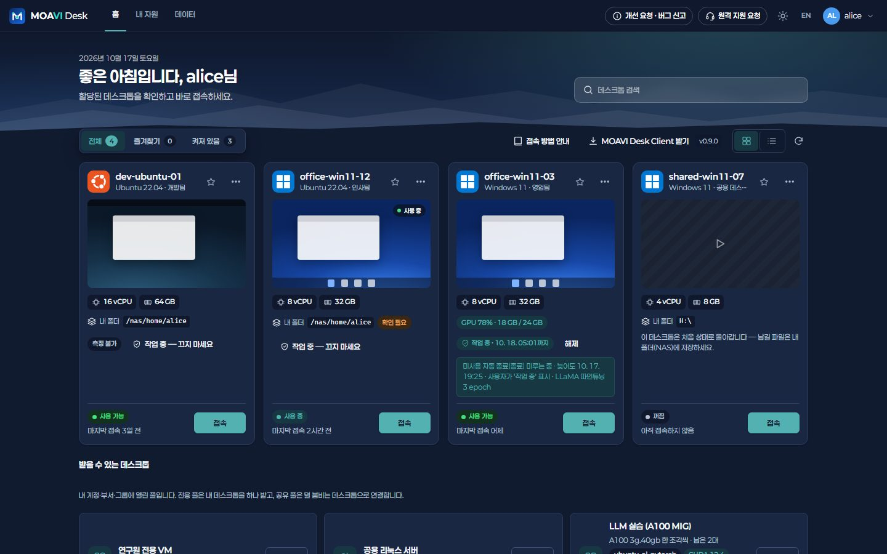 | 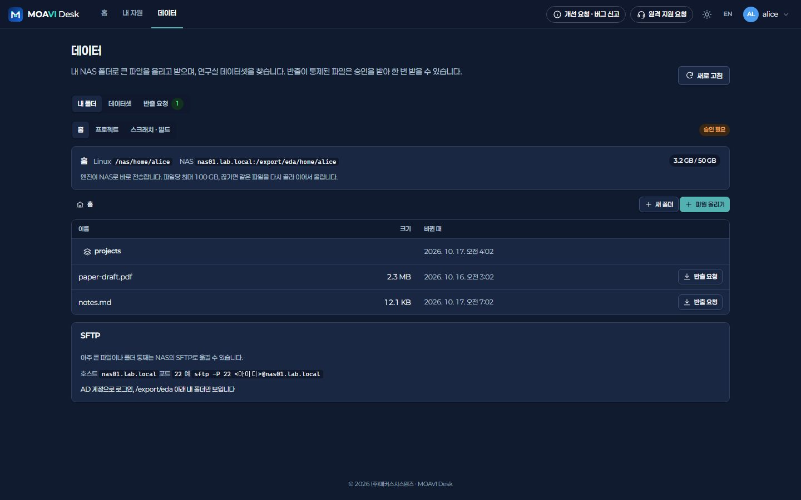 |
| **대시보드** | **증설 예측** |
| 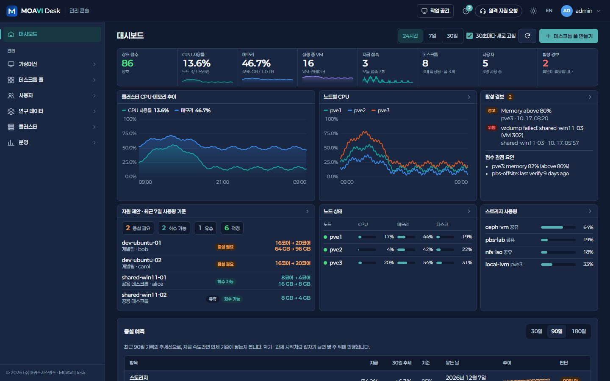 | 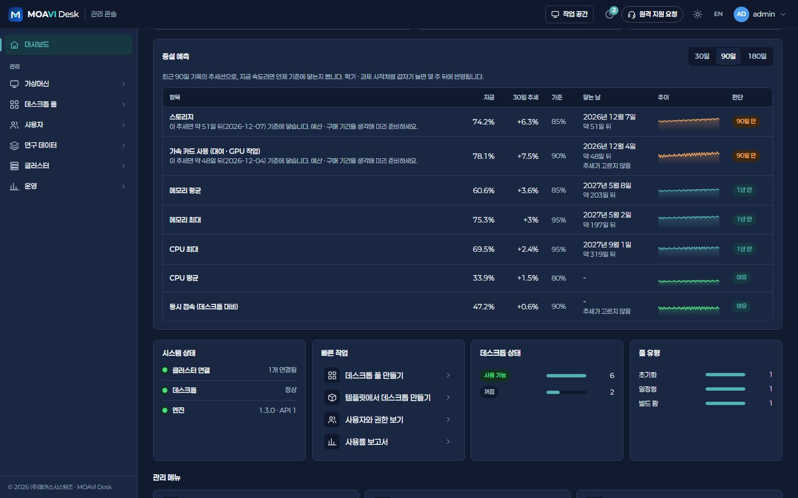 |
| **데이터셋 — 위치 · 풀 · 접근** | **반출 승인** |
| 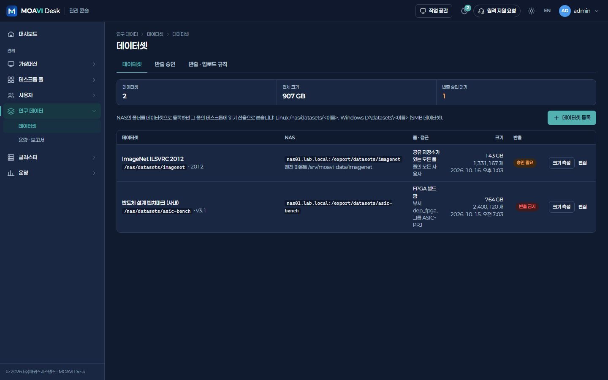 | 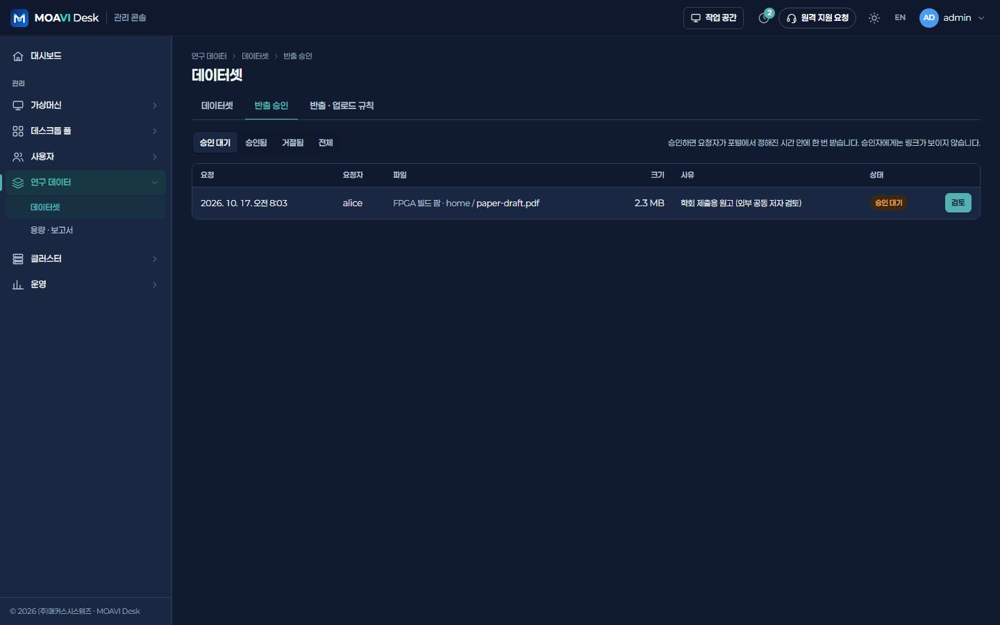 |
| **반출 보고서** | **공유 저장소 — 홈 · 프로젝트 · 스크래치** |
| 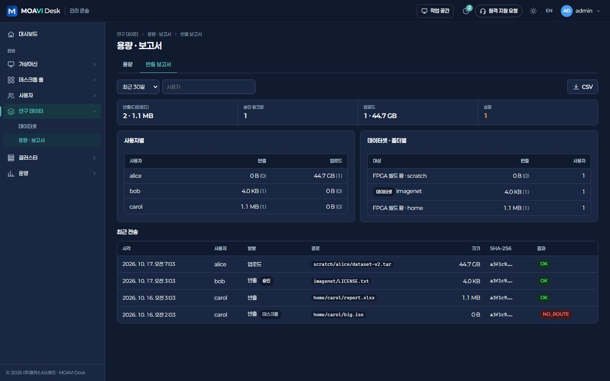 | 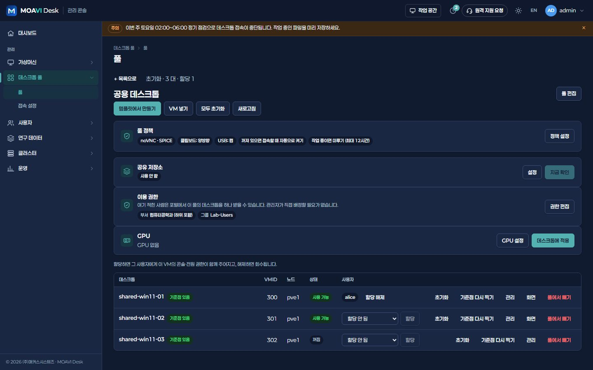 |
| **풀 이용 권한** | **고가용성(HA)** |
| 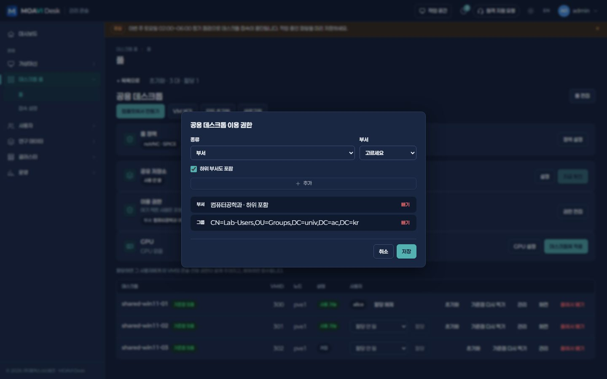 | 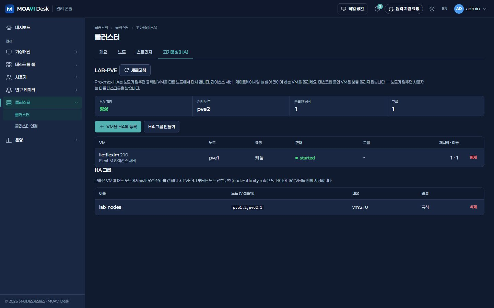 |
| **서버 이중화** | **역할** |
| 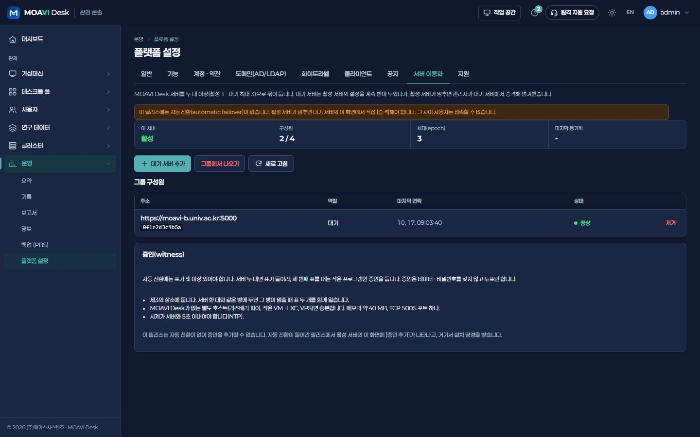 | 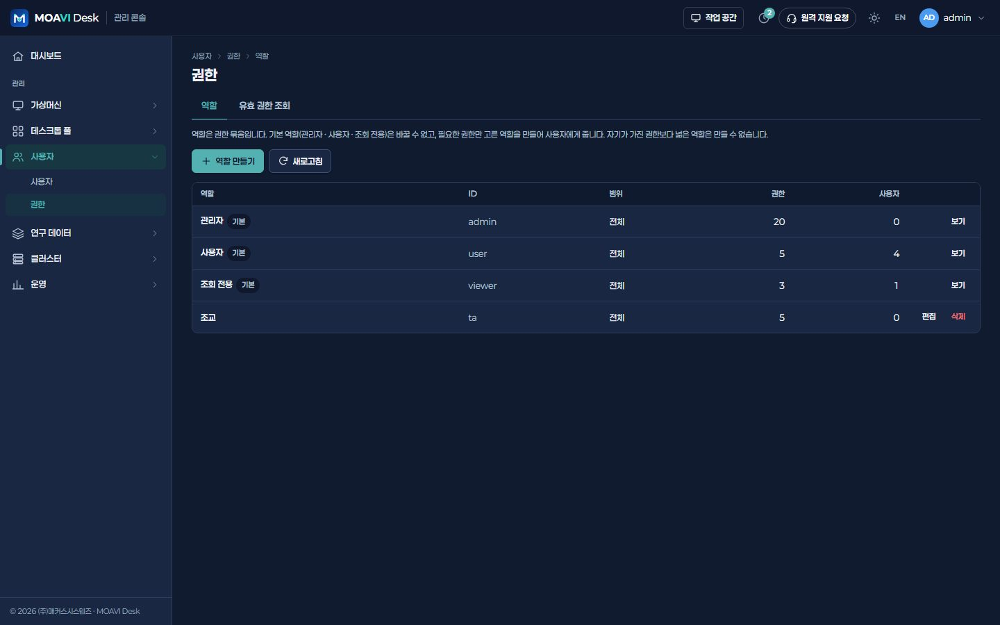 |
| **플랫폼 설정 › 기능 — 연구소 · 기업 R&D** | |
| 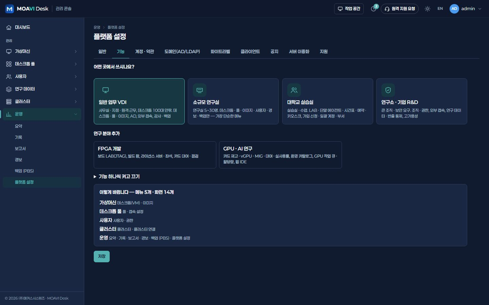 | |

## 구성 예시

예시입니다. 업무 프로그램 · 동시 접속 · 카드 모델에 맞춰 사양을 정합니다.

| 구분 | 구성 |
|---|---|
| 데스크톱 | 전용 VM 150대 · 4~8 vCPU · 16 GB |
| 서버 | 4노드 이상 · 노드당 CPU 2소켓 32코어 · 메모리 768 GB |
| 스토리지 | Ceph NVMe + NAS(홈 · 프로젝트 · 스크래치 · 데이터셋) |
| 네트워크 | 스토리지 25 GbE 이상, 외부 협력은 게이트웨이 |
| 관리 · 백업 | MOAVI Desk 활성 · 대기 서버 + PBS |

## 설치

1. [서버에 설치](../../deploy/README.md) — Linux 서버 한 대에 docker compose로 콘솔 · 엔진 · Guacamole을 올립니다.
2. 처음 관리자로 들어가면 **어떤 곳에서 쓰시나요?** 가 뜹니다 → **연구소 · 기업 R&D** 를 고르고 **이대로 시작**.
   무인 설치라면 `.env`에 `VLAB_PROFILE=research`.
3. 클러스터 연결 → (필요하면) AD/LDAP → 템플릿 · 골든 이미지 → 풀 → 이용 권한 순서로 준비합니다.

나중에 다른 기능이 필요하면 **운영 > 플랫폼 설정 > 기능**에서 묶음을 켜고 끕니다. 꺼도 데이터는 지워지지 않습니다.

---

MOAVI Desk는 **100% 무료 오픈소스**입니다(콘솔 · 엔진 AGPL-3.0, 클라이언트 MIT). 유상은 (주)매커스시스템즈의 구축 대행뿐입니다.
다른 사이트 종류: [일반 업무 VDI](general.md) · [대학교 실습실](university.md) · [FPGA · AI 연구실](fpgaai.md)
