# MOAVI Desk — 대학교 실습실

학과 · 단과대 실습실과 수업을 위한 구성입니다. 시간표 · 예약대로 데스크톱을 준비하고 끝나면 처음 상태로 되돌립니다.

| 사이트 프로필 | 켜지는 기능 | 관리 콘솔 |
|---|---|---|
| **대학교 실습실** | LAB(단말 · 시간표 · 예약 · 키오스크), 가입 · 대량 계정, 조직 · 권한 | 메뉴 6개 · 화면 15개 |

**관리 콘솔 메뉴** (이 구성에서 보이는 것만)

- 가상머신 — 데스크톱(VM) · 이미지
- 데스크톱 풀 — 풀
- 사용자 — 사용자(목록 · 가입 심사 · 부서) · 권한
- LAB — LAB(관리 · 단말) · 일정 · 예약(예약 · 사용 일정 · 일정형 풀)
- 클러스터
- 운영

## 무엇이 좋아지나

| | |
|---|---|
| **수업 준비 자동** | 주간 시간표대로 수업 전에 데스크톱을 켜 두고, 끝나면 초기화하거나 끕니다. |
| **실습실 예약** | 교수 · 조교가 LAB 전체 · 좌석 · 데스크톱을 예약하고, 정규 수업 · 다른 예약과 겹치면 자동으로 막습니다. |
| **실습실 PC 키오스크** | MOAVI Desk Client를 깐 실습실 PC에서 로그인하면 지금 수업의 데스크톱이 전체 화면으로 열립니다. |
| **학기 계정** | 가입 신청 · CSV 일괄 등록 · 만료일 · 비밀번호 찾기로 계정 문의를 줄입니다. |
| **집에서 과제** | 실습 프로그램이 든 데스크톱에 집에서도 브라우저로 접속합니다. |

## 화면

아래 화면은 이 구성(사이트 프로필)으로 켰을 때 그대로입니다 — 꺼진 기능의 메뉴는 보이지 않습니다.

| | |
|---|---|
| **작업 공간 — 내 데스크톱** | **포털 예약 — 지금 예약 · 달력** |
| 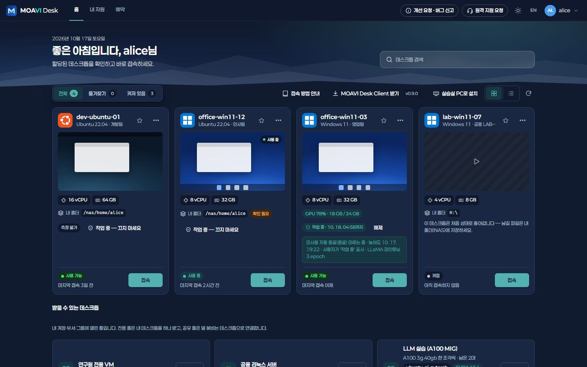 | 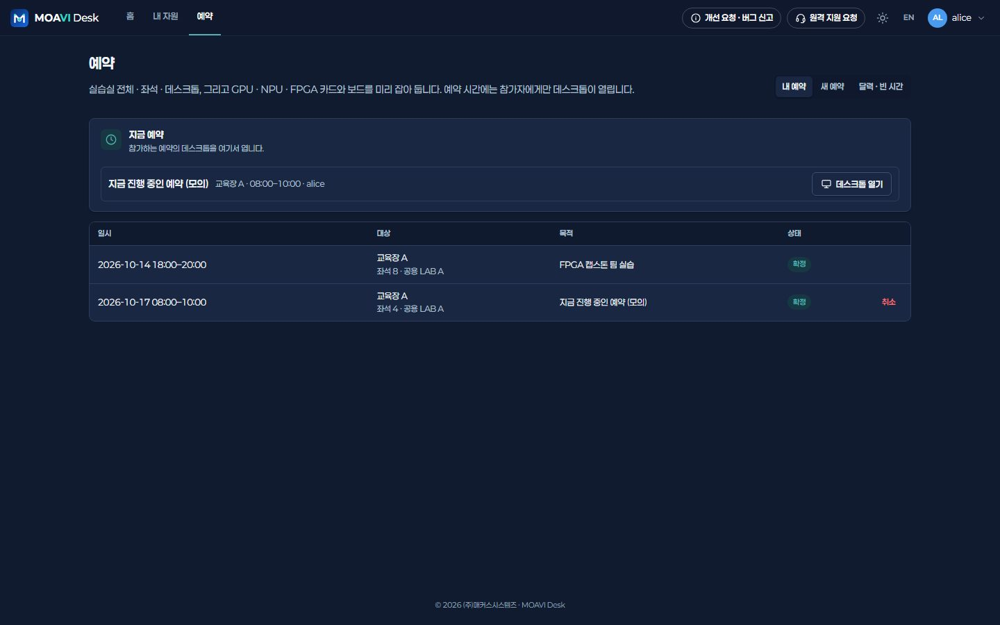 |
| **새 예약 — LAB 전체 · 좌석 · 데스크톱** | **LAB 키오스크 — 지금 수업 · 다음 수업** |
| 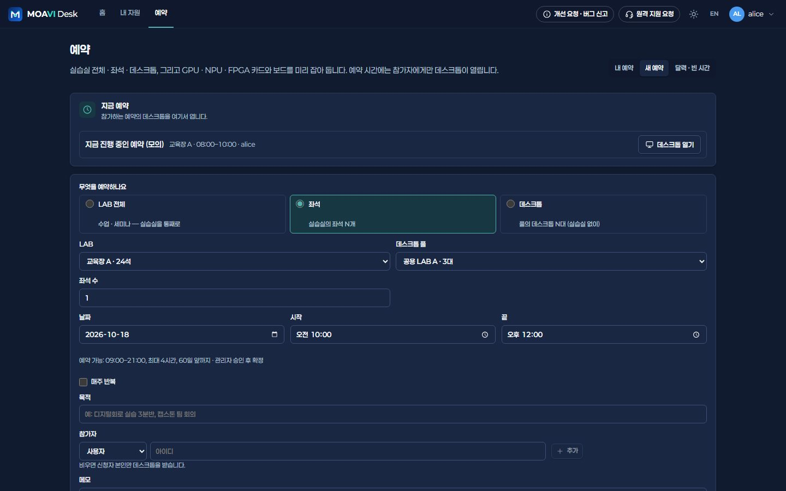 | 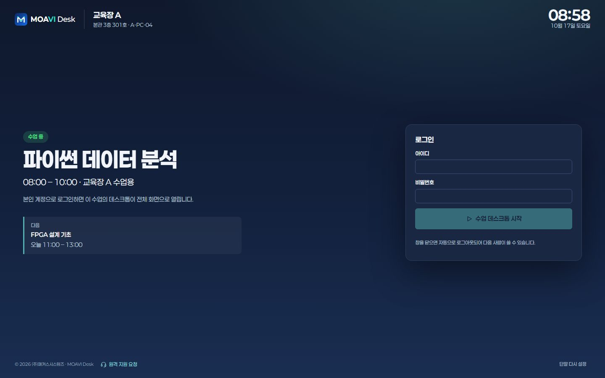 |
| **실습실 PC로 설치 — 조교가 직접** | **대시보드** |
| 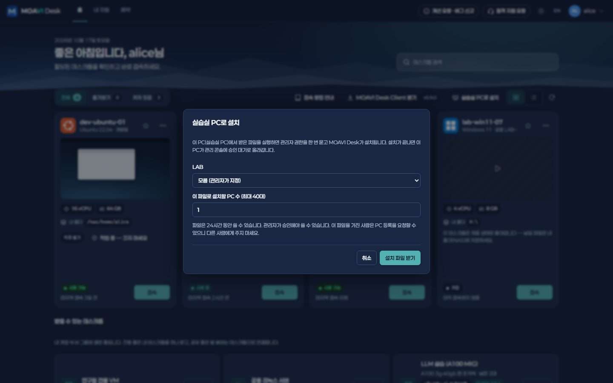 | 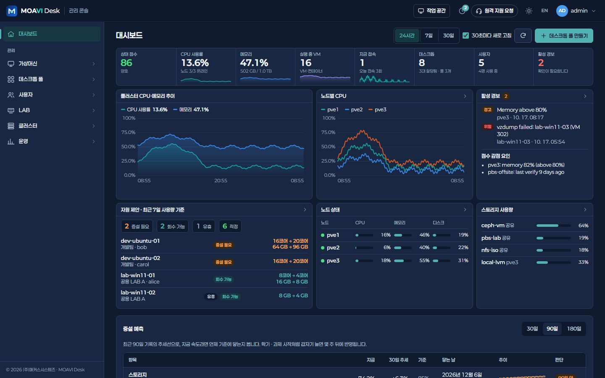 |
| **LAB › 단말 — 온라인 · 승인** | **일정 · 예약 › 예약 — 승인 · 충돌** |
| 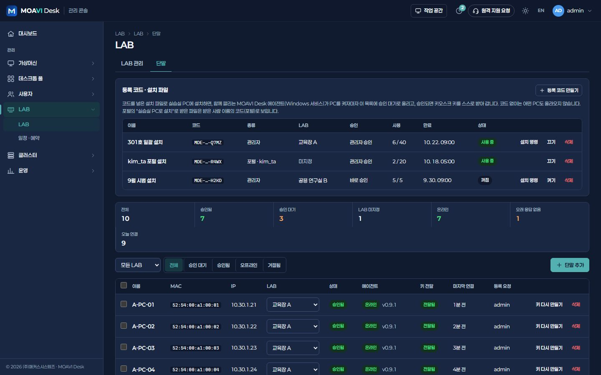 | 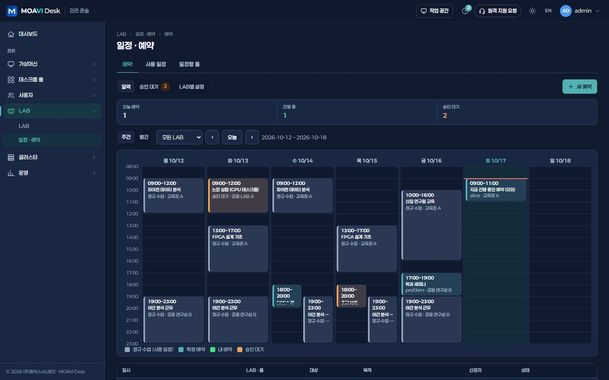 |
| **일정 · 예약 › 사용 일정 — 주간 시간표** | **예약 사용 보고서 — 노쇼** |
| 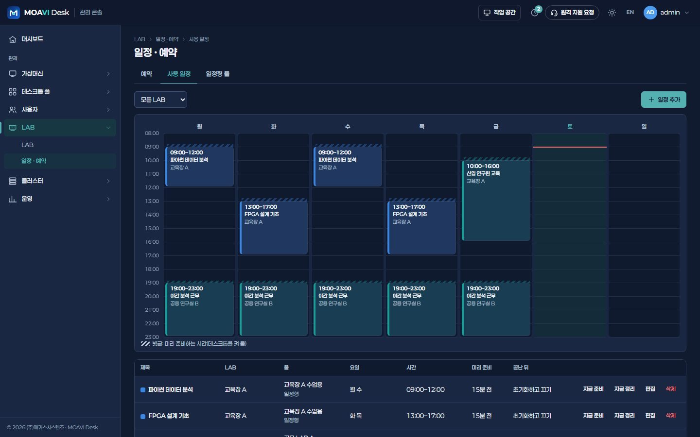 | 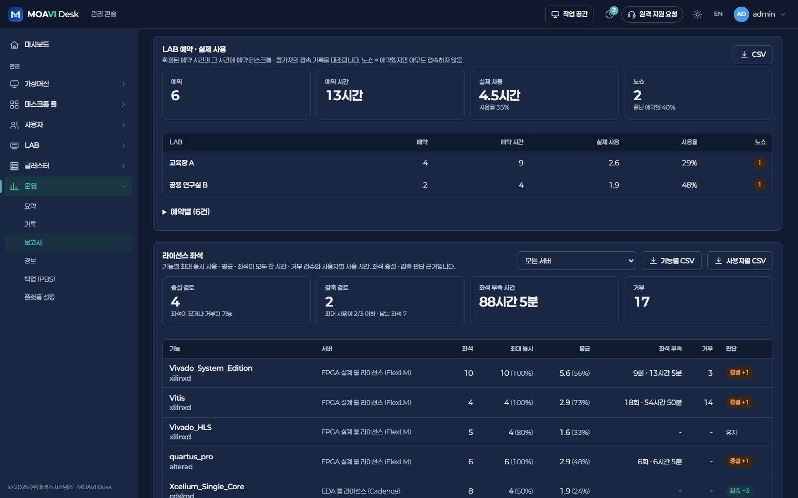 |
| **가입 심사** | **일괄 등록 — CSV** |
| 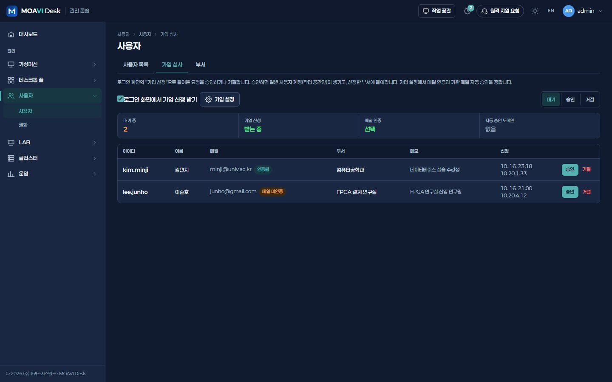 | 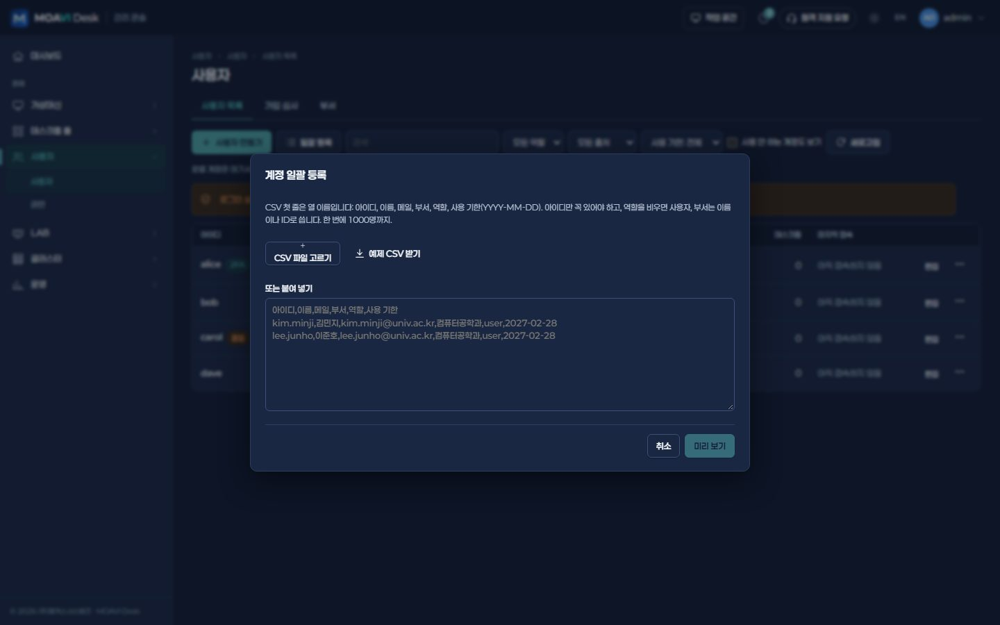 |
| **플랫폼 설정 › 기능 — 대학교 실습실** | |
| 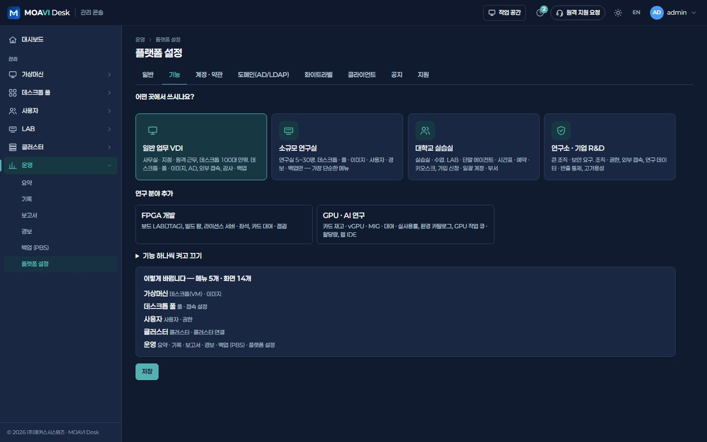 | |

## 구성 예시

예시입니다. 업무 프로그램 · 동시 접속 · 카드 모델에 맞춰 사양을 정합니다.

| 구분 | 구성 |
|---|---|
| 데스크톱 | 수업용 초기화 · 일정형 80대 + 학생 개인 VM |
| 서버 | 3노드 · 노드당 CPU 2소켓 32코어 · 메모리 512 GB |
| 스토리지 | Ceph NVMe 또는 공유 스토리지 · 링크 클론 |
| 실습실 PC | 기존 PC · 씬클라이언트에 MOAVI Desk Client + 에이전트 |
| 관리 · 백업 | MOAVI Desk 서버 1대 + PBS |

## 설치

1. [서버에 설치](../../deploy/README.md) — Linux 서버 한 대에 docker compose로 콘솔 · 엔진 · Guacamole을 올립니다.
2. 처음 관리자로 들어가면 **어떤 곳에서 쓰시나요?** 가 뜹니다 → **대학교 실습실** 를 고르고 **이대로 시작**.
   무인 설치라면 `.env`에 `VLAB_PROFILE=university`.
3. 클러스터 연결 → (필요하면) AD/LDAP → 템플릿 · 골든 이미지 → 풀 → 이용 권한 순서로 준비합니다.

나중에 다른 기능이 필요하면 **운영 > 플랫폼 설정 > 기능**에서 묶음을 켜고 끕니다. 꺼도 데이터는 지워지지 않습니다.

---

MOAVI Desk는 **100% 무료 오픈소스**입니다(콘솔 · 엔진 AGPL-3.0, 클라이언트 MIT). 유상은 (주)매커스시스템즈의 구축 대행뿐입니다.
다른 사이트 종류: [일반 업무 VDI](general.md) · [연구소 · 기업 R&D](research.md) · [FPGA · AI 연구실](fpgaai.md)
